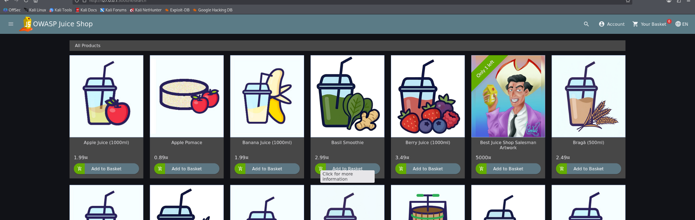
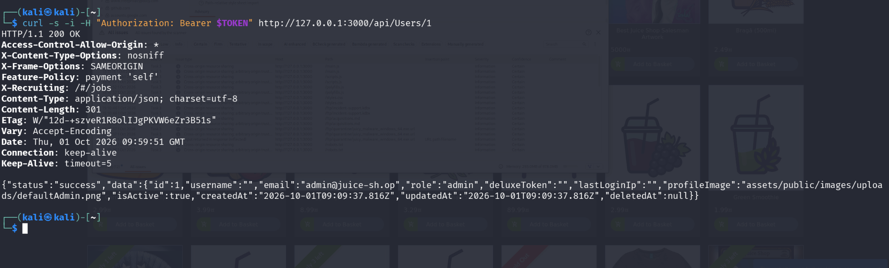
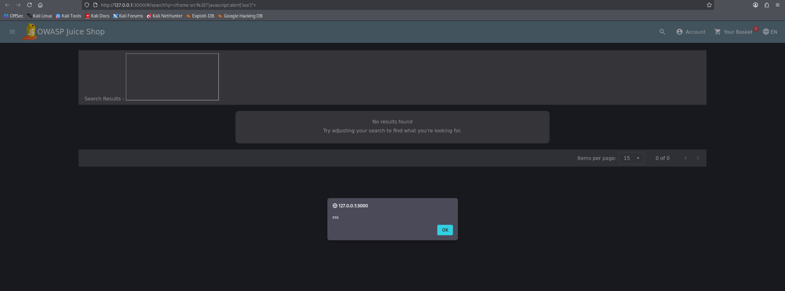
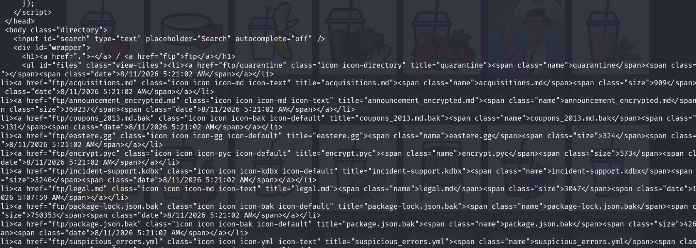
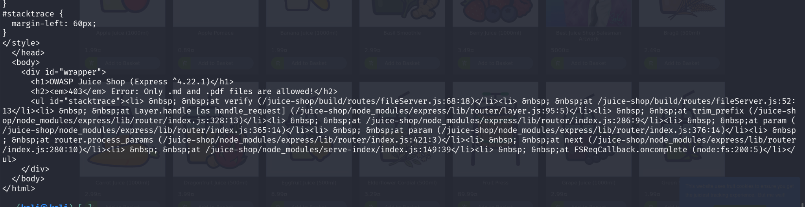
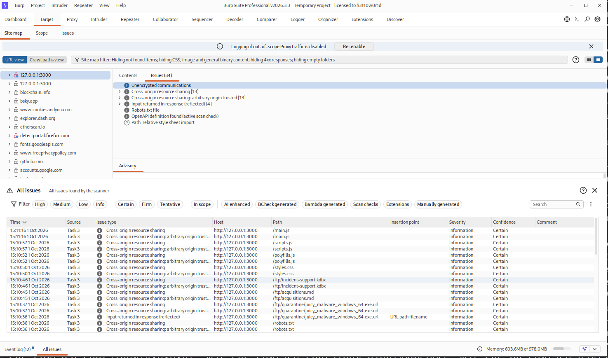
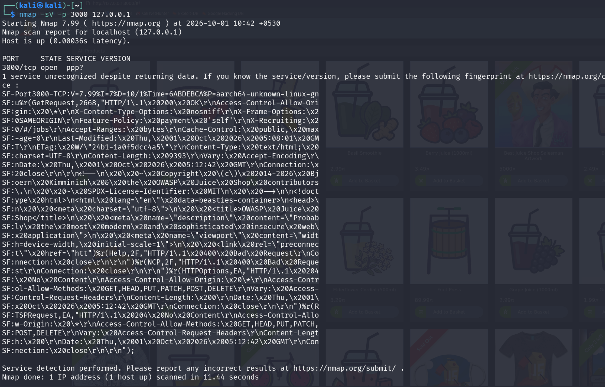

# Web Application VAPT — OWASP Juice Shop

A hands-on web application vulnerability assessment and penetration-testing lab performed against an intentionally vulnerable **OWASP Juice Shop** instance running locally in Docker.

> **Authorized lab only:** all testing documented here was performed against `http://127.0.0.1:3000`, an intentionally vulnerable local target.

## Project overview

This project demonstrates a practical web application VAPT workflow from reconnaissance through controlled validation, evidence collection, risk analysis, and remediation.

### Lab environment

| Component | Details |
|---|---|
| Analyst machine | Kali Linux |
| Target | OWASP Juice Shop |
| Deployment | Docker |
| Target URL | `http://127.0.0.1:3000` |
| Proxy | Burp Suite Professional |
| Tools | Nmap, WhatWeb, Nikto, cURL, Burp Suite Professional |

## Methodology

1. Lab setup and target validation
2. Reconnaissance and service identification
3. Web technology fingerprinting
4. Directory/file enumeration
5. Manual vulnerability testing
6. Burp Suite proxying and scoped crawling/auditing
7. Controlled validation of findings
8. Evidence collection
9. Risk analysis and remediation planning

## Confirmed findings

| ID | Finding | Severity | OWASP Top 10:2025 |
|---|---|---|---|
| VULN-01 | SQL Injection / Authentication Bypass | Critical | A05 — Injection |
| VULN-02 | IDOR / Broken Object Level Authorization | High | A01 — Broken Access Control |
| VULN-03 | Client-Side XSS | Medium | A05 — Injection |
| VULN-04 | Sensitive File Exposure via `/ftp` | Medium | A01 — Broken Access Control |
| VULN-05 | Verbose Error / Stack Trace Disclosure | Low–Medium | A10 — Mishandling of Exceptional Conditions |
| VULN-06 | Permissive CORS Configuration | Low–Medium | A02 — Security Misconfiguration |

Severity values are practical assessments for this lab and are not OWASP-assigned scores.

## Key evidence

### VULN-01 — SQL Injection / Authentication Bypass

The login endpoint accepted crafted SQL input and returned an authentication token associated with the administrative account.

Affected endpoint: `POST /rest/user/login`



### VULN-02 — IDOR / Broken Access Control

A dedicated customer account (user ID 25) was authenticated and then used to request `/api/Users/1`. The response exposed the administrator user record.



### VULN-03 — Client-Side XSS

A crafted search URL caused JavaScript execution in the browser and displayed an `xss` alert.



### VULN-04 — Sensitive File Exposure

The exposed `/ftp` path allowed retrieval of files including `acquisitions.md` and `legal.md`.



### VULN-05 — Verbose Error / Stack Trace Disclosure

Invalid requests produced verbose Express/Node.js error output containing implementation details and stack information.



### VULN-06 — Permissive CORS

Burp Suite identified an arbitrary-origin CORS trust configuration on multiple Juice Shop resources. This is treated as a configuration weakness; no stronger exploit impact is claimed without separate validation.



## Reconnaissance evidence

Nmap identified TCP/3000 as open on the local target.



## Remediation summary

- Use parameterized SQL queries and prepared statements.
- Enforce server-side object-level authorization for every API resource.
- Apply context-aware output encoding and safe DOM APIs to prevent XSS.
- Remove sensitive files from web-accessible directories.
- Return generic production errors and keep detailed stack traces in server-side logs.
- Restrict CORS to explicitly trusted origins and required methods/headers.

## Report

The detailed report is available in:

- `report/Project_2_Web_Application_VAPT_Report.pdf`
- `report/Project_2_Web_Application_VAPT_Report.docx`

## Evidence layout

```text
web-application-vapt/
├── README.md
├── report/
├── evidence/
│   ├── recon/
│   ├── sqli/
│   ├── xss/
│   ├── idor/
│   ├── information-disclosure/
│   └── burp/
└── docs/
```

## Disclaimer

This repository is a security-learning and portfolio lab using an intentionally vulnerable application. Testing was limited to the local target and performed for authorized educational purposes.
